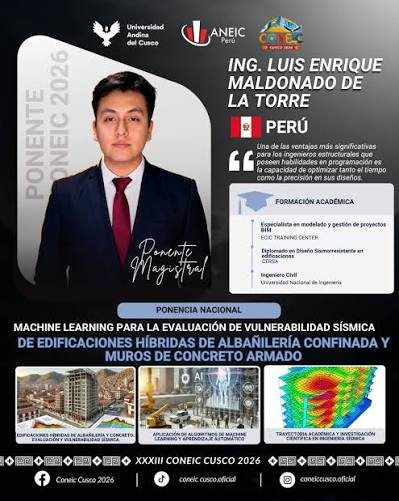
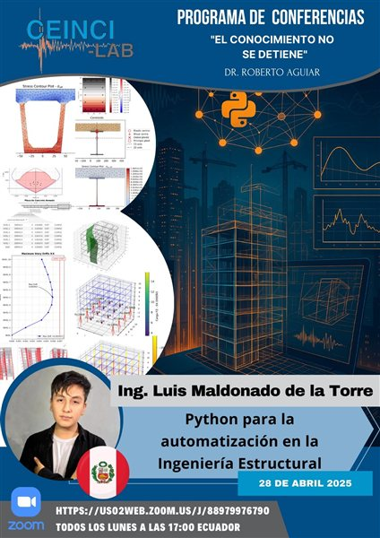
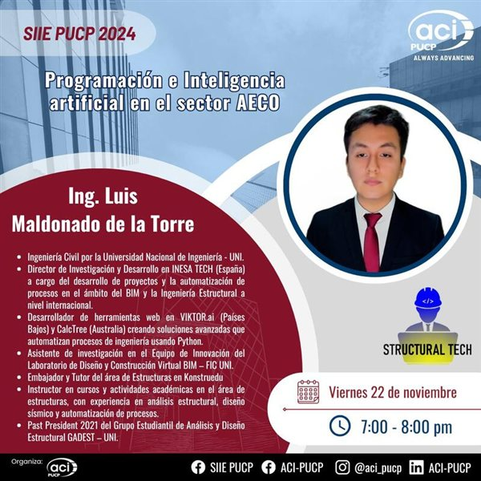
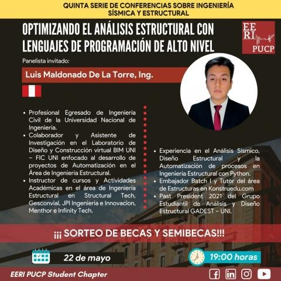
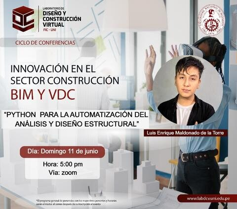

<!-- ============ HEADER ============ -->

  

  
  
  
  

---

## 👷‍♂️ Sobre mí

Soy **Ingeniero Civil** de la **Universidad Nacional de Ingeniería (Perú)** y actualmente curso el **Diplomado en Análisis Sísmico y Diseño Sismorresistente de Estructuras** en la **Pontificia Universidad Católica de Chile**. Me apasiona unir la ingeniería con la programación: desarrollo herramientas en **Python** para automatizar cálculos, verificar diseños y entender mejor el comportamiento de las estructuras.

Formo parte del **Directorio de Investigación y Desarrollo en INESA TECH (España)** y pronto estaremos dictando el taller *"Automatización en Ingeniería Estructural con Programación e IA"*

He sido **asistente de investigación** en el Equipo de Innovación del **Laboratorio de Diseño y Construcción Virtual BIM – FIC UNI**, y he trabajado en startups internacionales desarrollando apps web en **VIKTOR.ai** (Países Bajos) y **CalcTree** (Australia), orientadas a automatizar cálculos y verificaciones estructurales.

- **Trabajo en:** análisis y diseño de edificaciones de concreto armado
- **Programo:** scripts y apps para automatizar la ingeniería estructural
- **Me gusta compartir:** contenido técnico en [LinkedIn](https://www.linkedin.com/in/luis-maldonado-de-la-torre) y videos cortos en [TikTok](https://www.tiktok.com/@structural_tech) con Structural Tech

📫 **Contacto:** 
[lmaldonadod@uni.pe](mailto:lmaldonadod@uni.pe) 
[lmaldonadod@uc.cl](mailto:lmaldonadod@uc.cl)

---

## 🚀 Proyectos destacados

| Proyecto | Descripción | &nbsp;&nbsp;&nbsp;&nbsp;&nbsp;&nbsp;&nbsp;&nbsp;&nbsp;&nbsp;&nbsp;&nbsp;Stack&nbsp;&nbsp;&nbsp;&nbsp;&nbsp;&nbsp;&nbsp;&nbsp;&nbsp;&nbsp;&nbsp;&nbsp; |
|---|---|---|
| **Structural Design**  🚧 En desarrollo | Suite de diseño automatizado de elementos estructurales según la **E.060**: vigas, columnas y cimentación, con extracción en vivo del modelo de ETABS. |     |
| **[Diagrama de Interacción](https://github.com/LuisMaldonado-py/Diagrama-de-Interaccion)** | Cálculo y gráfica del diagrama de interacción P–M de columnas de concreto armado. |   |
| **[Mass-Spring-Damper 1GDL](https://github.com/LuisMaldonado-py/Mass-spring-damper--1-DOF)** | Simulación y animación de un sistema de 1 grado de libertad sometido a excitación en la base. |   |
| **[Python para Ing. Estructural](https://github.com/LuisMaldonado-py/Ejemplo-Libro-Ing-Estructural)** | Ejemplos prácticos de Python aplicado a vigas, columnas y secciones: NumPy, Pandas, SymPy, Matplotlib. |   |
| **[Portafolio](https://luismaldonado-py.github.io)** | Mi portafolio de ingeniería estructural. |  |

---

## Tecnologías y herramientas

**Programación**

  

**Softwares de Ingeniería Estructural**

  
  
  
  
  
  
  

---

## Publicaciones y charlas

Participo en eventos académicos —congresos, simposios, conferencias, talleres y webinars— donde divulgo sobre la **automatización de procesos en ingeniería estructural** y el uso de **IA y Machine Learning** para estimar la **vulnerabilidad sísmica** de edificaciones.

  
  
  
  
  

---

  <i>“Donde la ingeniería estructural se combina con la automatización.”</i>

